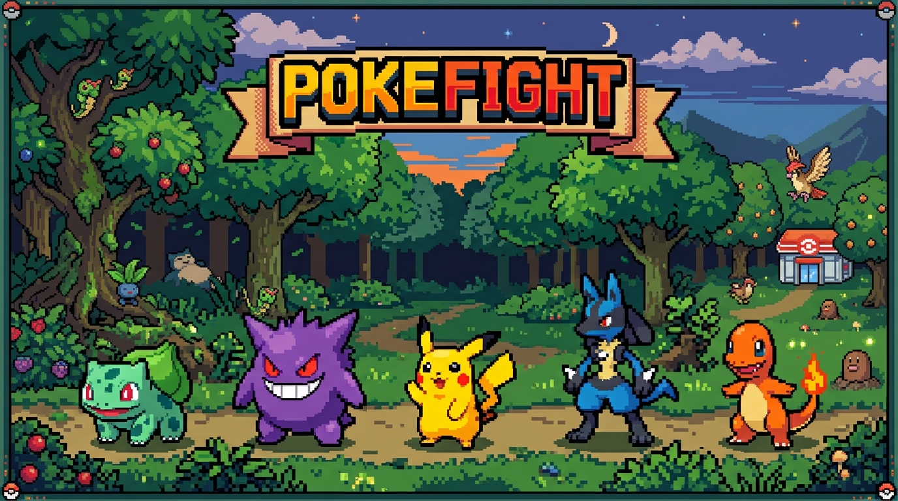
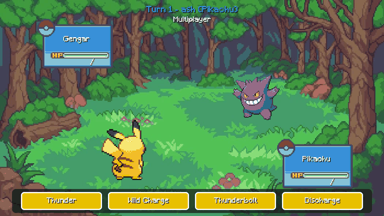
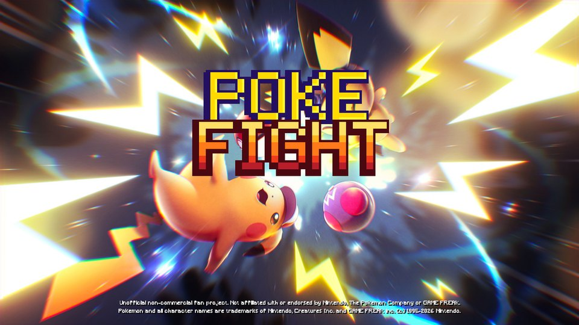
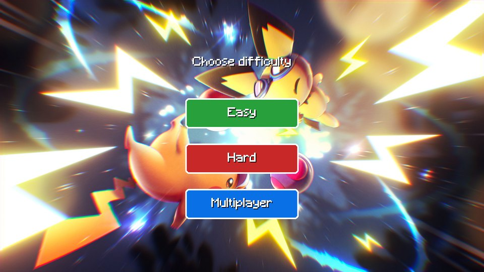
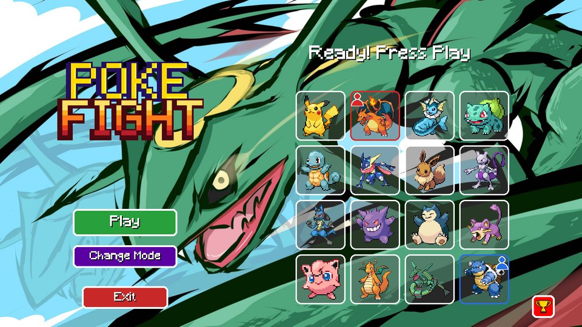
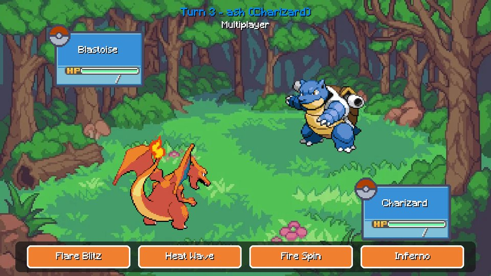
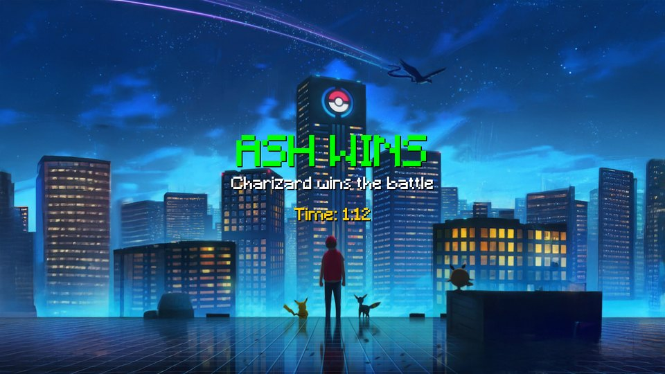
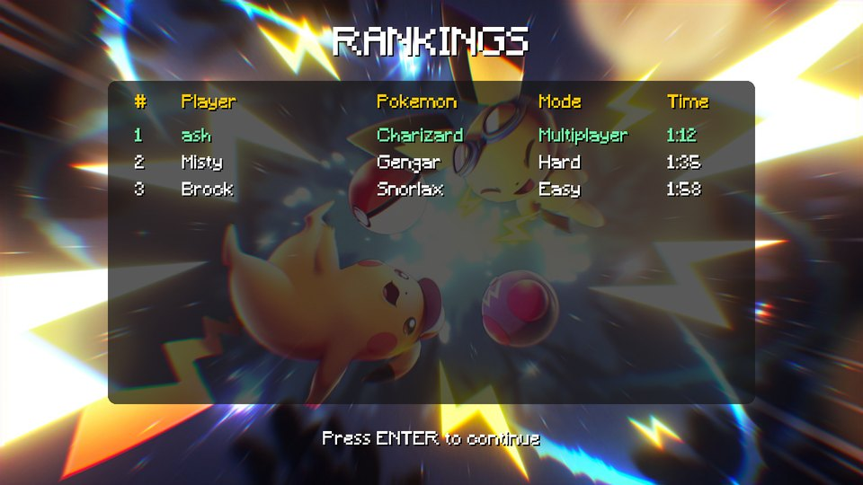

<div align="center">



# ⚡ PokeFIGHT ⚡

**A turn-based Pokémon battle game made with Python and Pygame, powered by real data from the PokéAPI.**

<p>
  
  
  
  
</p>
<p>
  
  
  
  
</p>



<sub>Pikachu uses Thunderbolt: the attacker lunges, the target flashes red and shakes, and the health bar drains.</sub>

</div>

---

## 📖 Table of contents

- [✨ Features](#-features)
- [📸 Screenshots](#-screenshots)
- [🚀 Quick start](#-quick-start)
- [🎮 How to play](#-how-to-play)
- [⌨️ Controls](#️-controls)
- [⚔️ Battle system](#️-battle-system)
- [🛠️ Debug console](#️-debug-console)
- [🎨 Customize it](#-customize-it)
- [🐳 Docker](#-docker)
- [📁 Project structure](#-project-structure)
- [🧰 Built with](#-built-with)
- [📜 Credits and legal](#-credits-and-legal)

---

## ✨ Features

| Feature | What you get |
| --- | --- |
| 🎮 **3 game modes** | **Easy** and **Hard** against the CPU, and **Multiplayer** for two players on the same computer |
| 🌐 **Real Pokémon data** | Stats, moves, types, sprites, animated GIFs and cries from PokéAPI, cached on disk after the first run |
| 🔥 **Type chart** | All 18 types: super effective ×2, not very effective ×0.5, no effect ×0, and dual types multiply |
| 💥 **Critical hits** | 1 in 16 attacks deals ×1.5 damage |
| 🎬 **Animated battles** | Attack lunge, red flash, shake, smooth health bars and animated sprites |
| ⚖️ **Balanced modes** | Easy is friendly, Hard gives the CPU more HP and smarter moves, Multiplayer always lasts 10+ turns |
| 🔐 **Accounts** | Register in its own window and log in; names can't be only spaces; passwords are salted PBKDF2-SHA256 hashes |
| 🏆 **Rankings** | The 10 fastest wins, with player, Pokémon, mode and time |
| 🎵 **Music and cries** | CC0 music for each screen and the real cry of every Pokémon |
| 🖥️ **Quality of life** | Resizable window, fullscreen, hot reload and an in-game debug console |

---

## 📸 Screenshots

<table>
  <tr>
    <td align="center"><br><b>Start</b></td>
    <td align="center"><br><b>Choose a mode</b></td>
  </tr>
  <tr>
    <td align="center"><br><b>Pick your Pokémon</b></td>
    <td align="center"><br><b>Battle</b></td>
  </tr>
  <tr>
    <td align="center"><br><b>Result</b></td>
    <td align="center"><br><b>Rankings</b></td>
  </tr>
</table>

---

## 🚀 Quick start

> [!NOTE]
> The **first** start needs internet and takes a little while: it downloads the data, images and cries of every Pokémon. After that the game opens in seconds and works offline.

```bash
git clone https://github.com/notfulii/PokeFIGHT.git
cd PokeFIGHT
pip install -r requirements.txt
python main.py
```

**Requirements:** Python 3.11 or newer (tested with Python 3.13).

---

## 🎮 How to play

1. Press <kbd>Enter</kbd> on the start screen.
2. **Log in**. No account yet? Click **Create account**, fill the register window and come back. Your account name is Player 1's name.
3. Choose **Easy**, **Hard** or **Multiplayer**.
4. Pick your Pokémon: 🔴 Player 1, 🔵 Player 2. Then press **Play**.
5. Click one of your 4 attacks. Press <kbd>Enter</kbd> or click to read each message.
6. When a Pokémon faints you see the winner, the battle time and the rankings.
7. In **Multiplayer**, if Player 2 wins they log in (or create an account) so the win is saved with their name. **Back** skips it.

---

## ⌨️ Controls

| Key | Action |
| :---: | --- |
| 🖱️ | Click buttons, Pokémon and attacks |
| <kbd>Enter</kbd> | Continue / confirm |
| <kbd>Tab</kbd> | Switch between text boxes |
| <kbd>Esc</kbd> | Leave the battle |
| <kbd>F11</kbd> | Fullscreen on / off |
| <kbd>R</kbd> / <kbd>F5</kbd> | Reload the code without closing the game |
| <kbd>&#96;</kbd> / <kbd>F1</kbd> | Open the debug console |

---

## ⚔️ Battle system

The fastest Pokémon attacks first, then the players take turns. Damage is:

```text
damage = (attack / defense) × (power / 10) × 2 × type effectiveness × critical
```

Special moves use special attack and special defense. On top of that, each mode has its own balance:

| Mode | Your HP | Rival HP | CPU damage | Max damage per hit | CPU picks |
| --- | :---: | :---: | :---: | :---: | --- |
| 🟢 **Easy** | ×1.15 | ×0.9 | ×0.8 | 60 % of HP | A random move |
| 🔴 **Hard** | ×1.0 | ×1.4 | ×1.25 | 60 % of HP | The strongest move, counting types |
| 🔵 **Multiplayer** | ×1.6 | ×1.6 | — | 18 % of HP | — |

> [!TIP]
> In Multiplayer no hit can take more than 18 % of the HP, so a match always lasts at least 11 turns.

---

## 🛠️ Debug console

Press <kbd>&#96;</kbd> or <kbd>F1</kbd> in the game (or type in the terminal) and write `help`.

| Command | Example |
| --- | --- |
| Jump to a screen | `go battle` · `go rankings` |
| Change the mode | `mode multiplayer` |
| Pick Pokémon | `pick pikachu gengar` |
| Set Player 1's name | `names ash` |
| Hurt / heal | `enemy 30` · `player 30` · `heal` |
| End the battle now | `win` · `lose` |

Turn it off with `DEBUG_ON = False` in `settings.py`.

---

## 🎨 Customize it

Every number, color, text and path lives in **`settings.py`**:

| Setting | What it changes |
| --- | --- |
| `POKEMON_NAMES` | The 16 Pokémon. Change a name (in English, as in PokéAPI) and it is downloaded automatically |
| `HP_BONUS`, `DAMAGE_MULTIPLIER`, `CRIT_CHANCE`, `TYPE_CHART` | The battle formula |
| `EASY_*`, `HARD_*`, `MULTIPLAYER_*` | The balance of each mode |
| `SCREEN_MUSIC`, `MUSIC_VOLUME`, `SOUND_ON` | Music and sound |
| `START_FULLSCREEN`, `FPS` | The window |

Stats and moves are saved in `assets/data/stats.json` and `assets/data/moves.json` and can be edited by hand.

---

## 🐳 Docker

The game opens a window, so the container needs a display from your computer.

```bash
docker build -t pokefight .
```

<details>
<summary><b>🪟 Windows</b></summary>

1. Install and open [VcXsrv](https://sourceforge.net/projects/vcxsrv/) with **"Disable access control"** checked.
2. Run:

```bash
docker compose up --build
```

</details>

<details>
<summary><b>🐧 Linux (X11)</b></summary>

```bash
xhost +local:docker
docker run --rm -it -e DISPLAY=$DISPLAY -v /tmp/.X11-unix:/tmp/.X11-unix -v pokefight-data:/app/assets/data -v pokefight-sprites:/app/assets/sprites -v pokefight-sounds:/app/assets/sounds pokefight
```

</details>

The volumes keep the downloaded Pokémon, the users and the rankings between runs. Inside Docker the sound is off by default (`SDL_AUDIODRIVER=dummy`).

---

## 📁 Project structure

<details>
<summary><b>Show the files</b></summary>

```text
PokeFIGHT/
├── main.py                    # Window, game loop and screen switching
├── settings.py                # Every configurable value
├── pokemon.py                 # Pokemon class: HP, stats, types, damage
├── battle_screen.py           # Turns, CPU, damage, animations, health bars
├── pokeapi.py · stats.py · moves.py · get_pokemon.py   # Download and cache the data
├── start_menu.py · login_screen.py · register_screen.py · difficulty_screen.py
├── select_pokemon_screen.py · result_screen.py · rankings_screen.py
├── ui.py · animation.py · backgrounds.py · transition.py · sound.py
├── auth.py · input_box.py · rankings.py · debug_console.py
├── assets/                    # Backgrounds, fonts, layout and music
├── docs/                      # Images for this README
├── Dockerfile · compose.yaml · requirements.txt
└── LICENSE.md
```

</details>

---

## 🧰 Built with

<p align="center">
  
</p>

<p align="center">
  <b>Python</b> · <b>Pygame</b> · <b>PokéAPI</b> · <b>Pillow</b> · <b>requests</b> · <b>Docker</b>
</p>

---

## 📜 Credits and legal

- 🗃️ **Data, sprites and cries:** [PokéAPI](https://pokeapi.co)
- 🎵 **Music:** CC0 tracks from [OpenGameArt](https://opengameart.org) (authors in [`assets/music/CREDITS.txt`](assets/music/CREDITS.txt))
- ⚠️ **Fan project:** PokeFIGHT is unofficial and non-commercial, made as a university assignment. It is not affiliated with or endorsed by Nintendo, The Pokémon Company or GAME FREAK. Pokémon © 1995–2026 Nintendo / Creatures Inc. / GAME FREAK inc. Full notice in [LICENSE.md](LICENSE.md).

<div align="center">

**If you like it, leave a ⭐**

</div>
